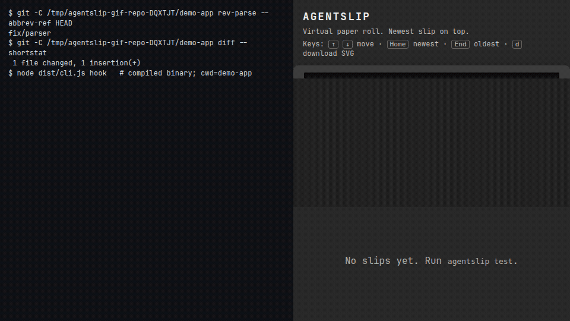

# agentslip — receipts for your coding agents

Claude Code and Codex hooks that print a small paper slip when your agent is **done**, when it **needs you**, and when the **session ends**. Use a network ESC/POS thermal printer (58 mm or 80 mm), or the built-in **virtual paper roll** in your browser — no hardware required.

The hook never blocks the agent (it always exits 0 in under 2 seconds), redacts [common secret patterns](#privacy) before a slip is rendered, and sends nothing anywhere except the printer you configure on your LAN. Tokens and cost are printed only when the session transcript contains them; otherwise the slip says `n/a`.

`agentslip hook` reads the JSON that Claude Code or Codex sends on stdin:

- **DONE** — Stop
- **NEEDS YOU** — Notification (Claude Code idle prompt) or PermissionRequest
- **SESSION** — SessionEnd

Default output is a **virtual paper roll** (SVG in `~/.agentslip/slips/` plus a local viewer). A network ESC/POS printer is optional.



## Who this is for

People who run **Claude Code** or **Codex** locally and want a paper-style receipt when the agent finishes, waits for input, or ends a session. No thermal printer is required. This is a local CLI, not a hosted service.

## 60-second try (virtual printer, no hardware)

Requires Node.js 22+.

```bash
npm install           # runs prepare → build
npm run demo          # three example tickets on the virtual roll
npm run viewer        # or: agentslip view
```

Open the URL printed by `view` / the Vite server. Newest slip is on top.

## Install (put `agentslip` on PATH)

The package is **private and not published to npm**. The binary the hooks run is `agentslip hook`, so it has to be on your PATH (or stored as an absolute `node …/dist/cli.js hook` command).

From a clone (`prepare` compiles `dist/` during `npm install`):

```bash
git clone https://github.com/EstebanIndiveri/agentslip
cd agentslip
npm install
npm link
agentslip test
```

Once the repository is **public**, the same `prepare` script is meant to make this work:

```bash
npm install -g github:EstebanIndiveri/agentslip
```

That GitHub URL install **cannot be tested while the repo is private** (npm gets 404). Do not treat it as verified. A local equivalent that *was* verified: `npm pack` then `npm install -g` of the tarball, and `npm link`, both followed by `agentslip test` in a clean HOME.

Without a global install, call the compiled file with an absolute path. `install --write` then stores that same command in the hook settings, **quoted** so a path with spaces works:

```bash
node /absolute/path/to/agentslip/dist/cli.js install --claude --write
```

If `agentslip` is already on `PATH`, install stores `agentslip hook`. Otherwise it stores `'<process.execPath>' '<absolute dist/cli.js>' hook`. That absolute form **pins the Node binary** (`process.execPath`). Switching Node with nvm or fnm will break the hook until you re-run `install --write`, or until you `npm link` so the command is `agentslip hook`.

## Install the hook (dry-run)

```bash
agentslip install --claude
agentslip install --codex
```

Nothing is written until you pass `--write`. That mode copies `settings.json.bak` (or `hooks.json.bak`) when that path is free. If a `.bak` already exists, the current file is copied to `settings.json.agentslip.bak` instead; neither backup is overwritten. The log line says which backup was written, or that none was. Invalid JSON, or a `hooks` value that is not an object, aborts and writes nothing.

Claude Code (`~/.claude/settings.json`), after `npm link`:

```json
{
  "hooks": {
    "Stop": [{ "hooks": [{ "type": "command", "command": "agentslip hook", "timeout": 2 }] }],
    "Notification": [{
      "matcher": "idle_prompt|agent_needs_input",
      "hooks": [{ "type": "command", "command": "agentslip hook", "timeout": 2 }]
    }],
    "PermissionRequest": [{ "hooks": [{ "type": "command", "command": "agentslip hook", "timeout": 2 }] }],
    "SessionEnd": [{ "hooks": [{ "type": "command", "command": "agentslip hook", "timeout": 2 }] }]
  }
}
```

The Notification matcher skips `permission_prompt` so a PermissionRequest does not print two NEEDS YOU slips. Claude Code also sends `idle_prompt` about a minute after Stop; agentslip skips that Notification when a DONE slip for the same session was printed in the last two minutes.

Codex (`~/.codex/hooks.json`):

```json
{
  "hooks": {
    "Stop": [{ "hooks": [{ "type": "command", "command": "agentslip hook", "timeout": 2 }] }],
    "PermissionRequest": [{ "hooks": [{ "type": "command", "command": "agentslip hook", "timeout": 2 }] }],
    "SessionEnd": [{ "hooks": [{ "type": "command", "command": "agentslip hook", "timeout": 2 }] }]
  }
}
```

In Codex, open `/hooks` and **review and trust** the agentslip commands before they will run.

The hook **always exits 0 in under two seconds**, even if the printer is down or the payload is invalid, so it does not block the agent. For **every** agent and event — including Codex Stop — it writes `{}` to stdout. Logs go to stderr / `~/.agentslip/agentslip.log`.

Remove only agentslip hook entries (dry-run unless `--write`):

```bash
agentslip uninstall --claude
agentslip uninstall --codex --write
# same: agentslip install --claude --uninstall --write
```

## Network ESC/POS printer

`~/.agentslip/config.json` (TypeScript type: `AgentslipConfig` in `src/types.ts`):

```json
{
  "driver": "escpos-tcp",
  "widthMm": 58,
  "escpos": { "host": "192.168.1.50", "port": 9100 }
}
```

- `widthMm`: `58` (32 columns) or `80` (48 columns)
- `driver`: `virtual` (default), `escpos-tcp`, or `file` (raw `.bin` under `~/.agentslip/` by default)
- Paper cut (`GS V` then `GS r 1`) is sent on ESC/POS only
- Bluetooth, USB, and CUPS are out of scope for v0.1

SVG and ESC/POS come from the **same** [ReceiptLine](https://github.com/receiptline/receiptline) document.

## Tested hardware: none yet — reports welcome

**Tested hardware: none yet — reports welcome.** v0.1 was checked in Cloud against a local fake TCP printer only. If you try a real network ESC/POS device, please file a [printer report](https://github.com/EstebanIndiveri/agentslip/issues/new?template=printer-report.yml) (model, width, connection, whether it worked, optional photo).

## Why not Bluetooth?

v0.1 sends ESC/POS over **TCP port 9100** on your LAN. Bluetooth, USB, CUPS, and pocket “cat printers” are not implemented. Bluetooth is under consideration. A network printer (Ethernet or Wi-Fi that speaks raw 9100) is the path that matches this release.

## Privacy

- No network except the printer host you configure on the LAN
- No telemetry, accounts, or cloud backend
- Common secret patterns are redacted before render (this is not a complete secret scanner): API-key-shaped tokens (including `gho_` / `ghs_` / `ghu_` / `ghr_`, `glpat-`, `hf_`, Stripe `sk_live_` / `rk_live_`), `Authorization: Basic`, credential URLs in any scheme, camelCase credential names (`apiKey`, `accessToken`, `clientSecret`, `stripeKey`, `masterKey`), glued names (`APIKEY=`, `apikey=`, `GITHUBTOKEN=`, `DBPASSWORD=`, `MYAPP_APIKEY=`, `DBPASS=`, `ADMINPASSWORD=`, `SLACKTOKEN=`), query strings (`?apikey=`, `&githubtoken=`), `MYSQL_PWD=`, underscore suffixes (`*_PASS` / `*_PASSWORD` / `*_SECRET` / `*_TOKEN` / `*_KEY` / `*_PWD` / `*_KEY_ID`), hyphenated headers (`x-api-key:` — the `:` or `=` is kept), quoted values with spaces (`API_KEY='a b'`), escaped JSON (`{\"apiKey\":\"…\"}`, including after `JSON.stringify` of Write `tool_input`), Python dicts (`{'apiKey': '…'}`), numeric JSON (`"apiKey": 1234`), JSON/dict string values that contain backslashes or escaped quotes, `--token=` / `--api-key` / `--password=`, `mysql` / `mysqldump` / `mysqladmin` / `mysqlimport` `-p<pw>` (not `-port` on a later command), PEM private-key blocks (including a BEGIN with no END), Slack `hooks.slack.com/services/…` URLs, typical `.env` lines. Each field is scanned 512 characters past 8 KB; the scan window is cut at the last whitespace before redacting (a split token is dropped; a 9 KB token with no spaces becomes `…`). `tool_input` walks are limited to 12 KB of string content and 32 levels of nesting. NEEDS YOU prints at most 8 wrapped request lines plus `… (+N lines)`. Plain words `bypass`, `hotkey`, `monkey`, `keyboard` (any case), bare `key` / `token` with a short identifier, data-model names (`primaryKey`, `sortKey`, `cacheKey`, `foreignKey`, `idempotencyKey`, `nextToken`), `token: string;`, JSX `key={…}`, `{"key": "Enter"}`, and `TURKEY=` are not treated as secret names. Long lines are truncated. Repo, branch, and session reason are redacted too. **Limitations:** a secret split across lines is not matched (bash `\` continuation, a token broken by a newline, `postgres://admin:` then a newline then the password). A JSON or assignment value longer than 4096 characters is left fully visible (the whole value, not only the tail). A backslash in a JSON field name is not matched.
- Default cap: 20 tickets per hour. Optional silent hours in `rateLimit.silentHours`.
- Tokens and cost print **only** when the session transcript actually contains them. Otherwise `n/a`. They are never estimated. If the transcript file is larger than 256 KB, only the tail is read and duration, turns, tools, tokens, and cost print as `n/a` (the tail is not the whole session).

## What was checked / limitations

Checked in Cursor Cloud (no physical printer): parsers against fixtures copied from the official hook docs, redaction, SVG + ESC/POS snapshots (ESC `@` start, `GS V` then `GS r 1` cut), a local TCP fake printer, hook exit 0 with the printer down, with invalid JSON, with never-closing stdin, and with a FIFO or large transcript file (SESSION fields `n/a` when the file exceeds 256 KB), rate limit, `install` dry-run vs `--write` (invalid JSON abort, single `.bak` that is not overwritten if it already contains agentslip, uninstall that leaves foreign `cli.js hook` / `agentslip-fork` commands), Vitest, Playwright Chromium on the viewer.

**No hardware thermal printer model was verified.** Do not treat v0.1 as “works on TM-XX / RP-YY” until someone tests a real device.

Hook payload fields that are not in the vendor docs (including **transcript file format**) are marked best effort. See `fixtures/*/*.manifest.json` and `fixtures/transcripts/README.md`.

Out of scope: Bluetooth “cat printers”, USB, CUPS, non-ESC/POS printers, Cursor / Gemini CLI / opencode hooks, npm publish.

GitHub Actions is disabled on this repository. `docs/ci-example.yml` is an inactive example — do not place workflows under `.github/workflows/`. Issue forms under `.github/ISSUE_TEMPLATE/` are not Actions.

## Adding an agent

See [docs/adding-an-agent.md](docs/adding-an-agent.md). Short version: one parser file in `src/hooks/`, fixtures + manifest with the doc URL, wire it in `src/hooks/parse.ts`. No plugin system. To request Cursor, Gemini CLI, opencode, or another agent, use the [agent request](https://github.com/EstebanIndiveri/agentslip/issues/new?template=agent-request.yml) form.

## Contributing

1. Node 22+, `npm install` (runs `prepare` → build)
2. Chromium for the viewer tests: `npx playwright install chromium` (Linux: `--with-deps` if needed)
3. `npm run typecheck` and `npm test`
4. Keep the hook non-blocking. Do not invent metrics, testimonials, or hardware claims.

Scripts: `npm run build`, `npm run typecheck`, `npm test`, `npm run viewer`, `npm run demo`.

Record the demo GIF: `bash scripts/record-demo.sh` (needs Playwright Chromium and `ffmpeg` or Python Pillow).

## How it was built

v0.1 was implemented with a Cursor Cloud agent and then reviewed. It is not a “built with Claude Code” project. No physical printer was in the loop.

## Credits

- Ticket rendering: [receiptline](https://github.com/receiptline/receiptline) (Apache-2.0). `receiptline.transform()` builds both SVG and ESC/POS from one document.
- Hook payload shapes: [Claude Code hooks](https://code.claude.com/docs/en/hooks) and [Codex hooks](https://learn.chatgpt.com/docs/hooks) (read 2026-10-28).
